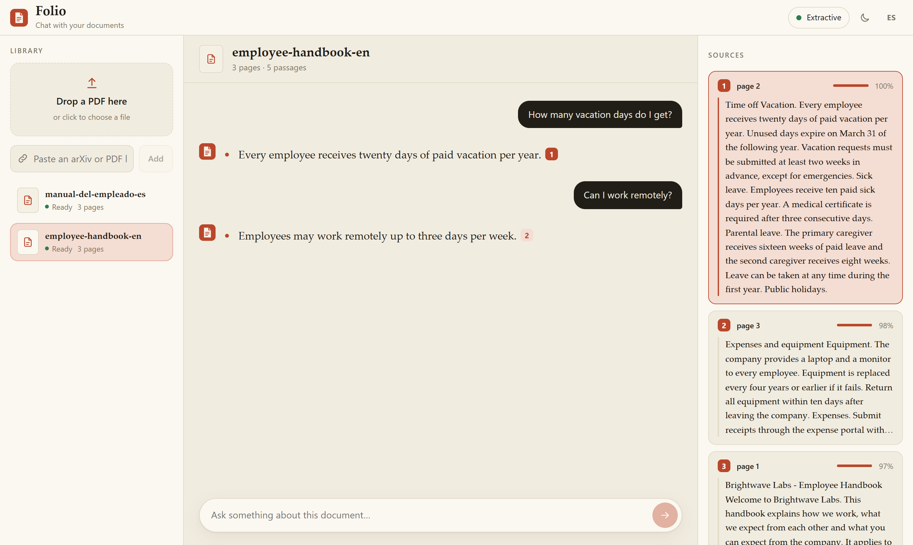
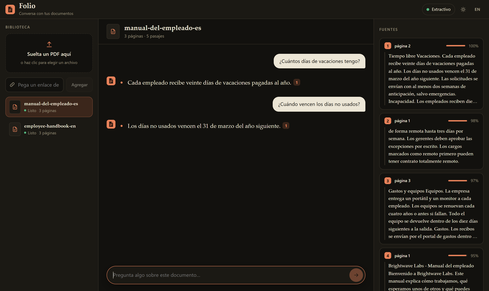
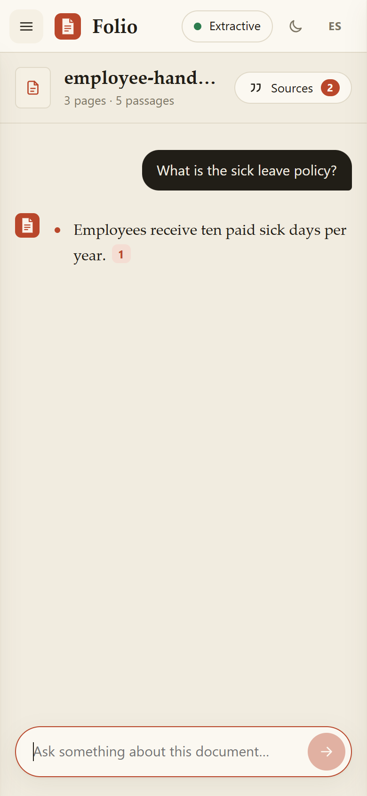
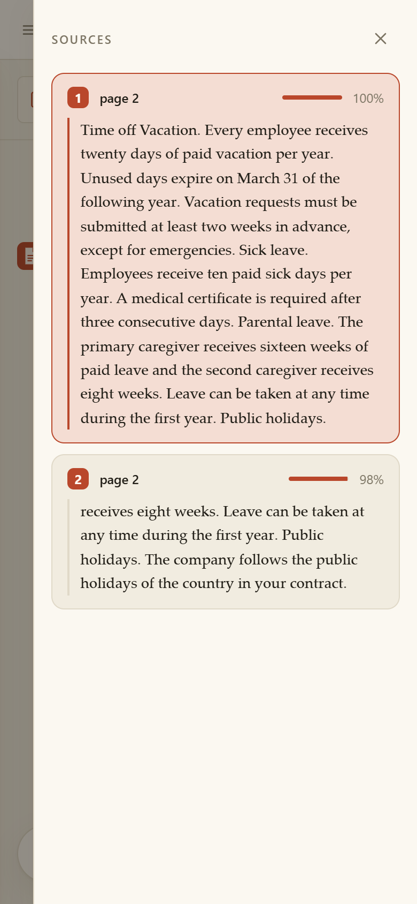
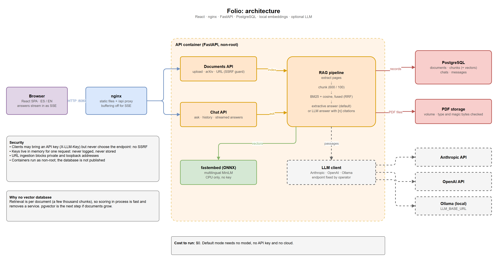
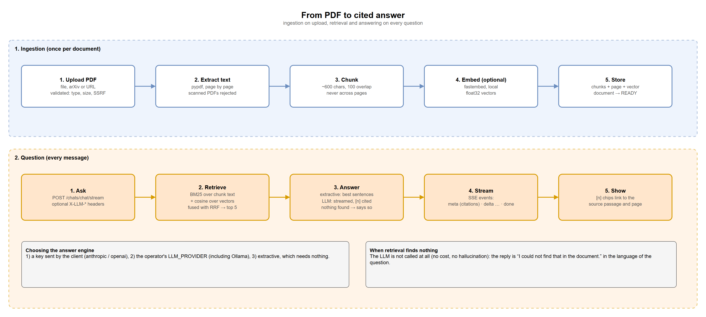

# Folio

Chat with your PDFs. Every answer comes with the page it was found on, it works in English and Spanish, and it runs with **no API key** unless you want one.


[](https://github.com/andresazcona/Folio/actions/workflows/ci.yml)



<p align="center">  </p>

## Why

Handbooks, contracts and papers are long and nobody reads them end to end. Folio lets you ask a question and shows you the exact passage that answers it, so you can check it instead of trusting it.

- **Cited answers.** Each answer links to the passage and page it came from, with a relevance bar.
- **Works without AI.** The default engine quotes the most relevant sentences of your document: free, private, and it cannot invent anything. Turn on an LLM if you want prose.
- **Your document stays yours.** Retrieval runs on your machine, and embeddings are computed locally (ONNX, CPU).
- **Spanish and English**, in the interface and in the documents, with accent-insensitive matching.
- **Streams as it answers** (server-sent events) and can be stopped mid-way.

The interface comes in light and dark, adapts to phones (the library and the sources open as drawers) and switches between Spanish and English.

## Quick start

```bash
docker compose up --build        # http://localhost:8080
```

Drop a PDF (try `samples/employee-handbook-en.pdf` or `samples/manual-del-empleado-es.pdf`), or paste an arXiv link, and start asking. The first build downloads a 200 MB multilingual embedding model into the image.

Without Docker:

```bash
cd backend  && pip install -e ".[embeddings]" && uvicorn app.main:app --reload   # :8000
cd frontend && npm install && npm run dev                                        # :5173
```

Without the `[embeddings]` extra, retrieval is keyword-only (BM25), which is already good for most documents.

## Choosing how answers are written

| Engine | Needs | What you get |
|---|---|---|
| **Extractive** (default) | nothing | The best sentences from your document, quoted and cited. |
| **Anthropic / OpenAI** | an API key | A natural answer written from the retrieved passages. Each visitor can bring their own key from the settings dialog. |
| **Ollama or any OpenAI-compatible server** | `LLM_PROVIDER=ollama`, `LLM_BASE_URL` | A fully local LLM. Start it with `docker compose --profile ollama up`. |

When retrieval finds nothing, the LLM is not called: Folio answers "I could not find that in the document." (in the language of the question) instead of guessing.

## How it works



1. **Ingest.** The PDF is validated (type, size, magic bytes, SSRF guard for URLs), its text is extracted page by page, split into ~600 character chunks that never cross a page, embedded locally and stored.
2. **Retrieve.** A question is scored against the chunks of that document with BM25 and, when embeddings are on, cosine similarity. The two rankings are merged with reciprocal rank fusion, so a question that shares no words with the answer ("time off" vs "vacation") can still find it.
3. **Answer.** Extractive mode picks the sentences covering the most question terms. LLM mode prompts with numbered passages and asks for `[n]` citations.
4. **Stream.** The API sends `meta` (citations), `delta` (text) and `done` events. The UI turns `[n]` into chips that scroll to the source passage.



### API

Interactive docs at `/docs`. The core calls:

| Call | Purpose |
|---|---|
| `POST /api/v1/documents/upload` · `/url` · `/arxiv` | Add a document. It returns `READY` or `FAILED` with a reason. |
| `GET /api/v1/documents` | List documents with page and chunk counts. |
| `POST /api/v1/chats/chat` | Ask a question, get `answer` + `citations`. Creates a chat unless `chat_id` is given. |
| `POST /api/v1/chats/chat/stream` | Same, as server-sent events. |
| `GET /api/v1/chats/{id}` | The conversation with its citations. |

Optional headers on the chat calls choose the engine for that request: `X-LLM-Provider` (`anthropic` or `openai`), `X-LLM-Key`, `X-LLM-Model`.

## Decisions worth knowing

- **No vector database.** Retrieval is per document, a few thousand chunks at most, so scoring in process is fast and removes a service to run. pgvector is the next step if documents grow.
- **Extractive by default.** It is cheap, private and verifiable. An LLM is an option, never a requirement.
- **Clients bring a key, never an endpoint.** Letting a caller choose where the server sends requests is an SSRF hole, so custom base URLs (Ollama, vLLM) are operator configuration only. Keys live in memory for one request and are never logged or stored.
- **Chunks never cross pages**, so every citation has an exact page.
- **Streaming opens its own database session**, because the request-scoped one is closed before a streamed body finishes.

## Security notes

- URL and arXiv ingestion blocks private, loopback and link-local addresses and limits size and time.
- Uploads are checked by extension and magic bytes, with a size limit that nginx and the API share.
- Containers run as non-root, and the database is not published to the host.
- There is no authentication: this is a single-tenant tool for your own documents. Put it behind your own login before exposing it.

## Tests

```bash
cd backend  && pytest -q          # 70 tests: retrieval, answers, providers (mocked HTTP), end-to-end API
cd frontend && npm test           # SSE parsing, including multi-byte characters split across chunks
bash scripts/smoke.sh             # against a running stack: upload, ask, stream, Spanish
```

CI runs lint, both test suites, then builds both images, starts the whole stack with `docker compose` and runs the smoke test through nginx.

## Project layout

```
backend/app/rag/        extract, chunking, retrieval (BM25 + cosine), answers, LLM providers
backend/app/services/   ingestion, chat, document management
backend/app/api/v1/     documents, chats (SSE), meta
frontend/src/           React app: sidebar, chat with citations, settings, ES/EN
docs/diagrams/          draw.io source and exported PNGs
samples/                two fictional handbooks (EN, ES) generated by backend/scripts/make_samples.py
```

## Limits and what is next

- Scanned PDFs (images without text) are rejected with a clear message. OCR would be the next addition.
- One document per conversation. Searching across several documents is not built yet.
- Tables lose their layout when text is extracted.
- Tables are created at startup; Alembic migrations are not written yet.

## License

MIT
